<!-- prettier-ignore -->
<div align="center">

<picture>
  <source media="(prefers-color-scheme: dark)" srcset="docs/assets/mydria-logo-dark.svg" />
  <source media="(prefers-color-scheme: light)" srcset="docs/assets/mydria-logo.svg" />
  
</picture>

# Mydria

**Sistem Skrining Tingkat Keparahan Retinopati Diabetik Berbasis Visi Komputer dan Deep Learning (APTOS 2019)**

[](pyproject.toml)
[](src/visikom_dr/models.py)
[](backend/model_service.py)
[](backend/app.py)
[](frontend/package.json)
[](frontend/src/styles/index.css)
<br />
[](docs/PROGRESS.md)
[](docs/PROGRESS.md)

Proyek UAS Visi Komputer dan Robotika (Semester 7): pipeline audit dataset bebas kebocoran duplikat, gerbang kualitas citra fundus OpenCV, studi ablasi 15 epoch pada Kaggle T4 GPU, kalibrasi probabilitas, visualisasi `Grad-CAM++`, dan aplikasi web *mobile-first* `Mydria`.

[Ikhtisar](#ikhtisar) • [Galeri Antarmuka](#galeri-antarmuka) • [Hasil Eksperimen](#hasil-eksperimen) • [Arsitektur Sistem](#arsitektur-sistem) • [Cara Menjalankan](#cara-menjalankan) • [Kontrak API](#kontrak-api) • [Dokumentasi](#peta-dokumentasi)

<br />

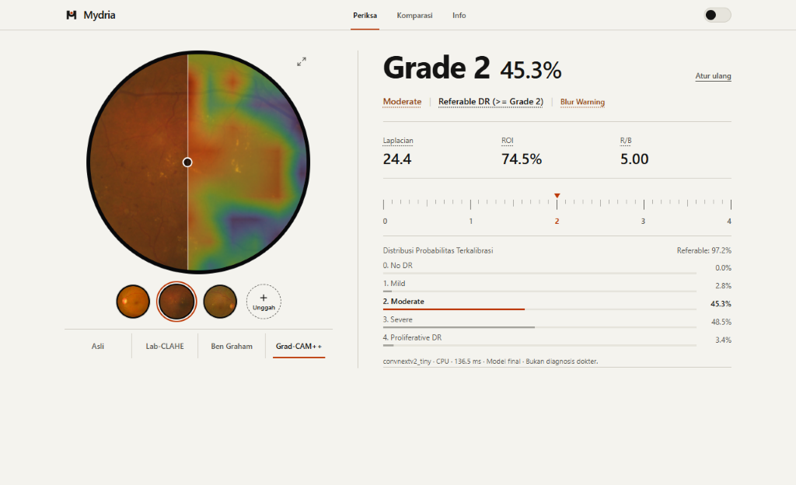

</div>

> [!WARNING]
> **Batasan Akademik:** Perangkat lunak ini dibangun untuk penelitian dan pembelajaran mata kuliah Visi Komputer dan Robotika, bukan alat diagnosis medis klinis maupun pengganti evaluasi dokter spesialis mata.

---

## Ikhtisar

Sebagian besar implementasi klasifikasi retinopati diabetik mengalami kebocoran partisi akibat foto duplikat pasien, selisih prapemrosesan antara skrip pelatihan dan server (*train-serve skew*), serta kolaps prediksi pada kelas minoritas. Repositori ini menyelesaikan persoalan tersebut dalam satu alur terintegrasi dari paket Python bersama [src/visikom_dr/](src/visikom_dr/__init__.py) hingga aplikasi web **Mydria** ([backend/](backend/app.py) dan [frontend/](frontend/src/App.tsx)):

- **Audit Duplikasi Berbasis Konten Retina ([audit_dataset.py](src/visikom_dr/audit_dataset.py)):** Menghitung `pHash` dan `dHash` pada wilayah dalam cakram retina (`circular_roi_crop` dengan pangkasan tepi `15%`), mengelompokkan duplikat dengan *Union-Find* (`phash <= 4` dan `dhash <= 4`), lalu mempartisi 5 *fold* berstrata pada tingkat klaster sehingga citra satu klaster tidak tersebar ke data latih dan uji.
- **Prapemrosesan & Gerbang Kualitas OpenCV ([preprocessing.py](src/visikom_dr/preprocessing.py), [quality_gate.py](src/visikom_dr/quality_gate.py)):** Menyediakan mode `raw_resize`, `crop_only`, `lab_clahe`, dan `ben_graham` pada resolusi `384 x 384`, disertai filter penolak citra non-fundus (`ROI < 15%` atau `R/B < 1,25` atau `R/G < 1,03`) dan detektor buram `Laplacian` (`< 25,0`).
- **Studi Ablasi Terstruktur (`E1-E4`, [train.py](src/visikom_dr/train.py)):** Membandingkan empat metode prapemrosesan (`E1`), tiga generasi arsitektur `ResNet-50`, `EfficientNet-B0`, dan `ConvNeXt-V2-Tiny` (`E2`), serta empat fungsi *loss* termasuk regresi ordinal `CORN` dan `SmoothL1Loss` dengan optimasi ambang *Nelder-Mead* (`E3`).
- **Inferensi ONNX Ganda + Antarmuka Web *Mobile-First* ([calibration_xai.py](src/visikom_dr/calibration_xai.py), [DESIGN.md](DESIGN.md)):** Mengekspor `model_best.onnx` berkeluaran ganda (`raw_output` dan `cam_maps` `12 x 12` untuk `Grad-CAM++`), lalu menyajikannya melalui API `FastAPI` ke aplikasi React bertema **Braun Paper & Graphite** lengkap dengan slider pembanding `0-100%`, modal diagram SVG, tab komparasi hasil, dan *theme switch* terang/gelap.

---

## Galeri Antarmuka

Antarmuka `Mydria` dibangun mengikuti spesifikasi [DESIGN.md](DESIGN.md) dengan pendekatan editorial tanpa tumpukan kartu generik, mendukung mode terang (*Braun Paper*) maupun gelap (*Braun Graphite*), serta navigasi kapsul *Frosted Segmented Island* di layar seluler.

<table align="center">
  <tr>
    <td align="center" width="50%">
      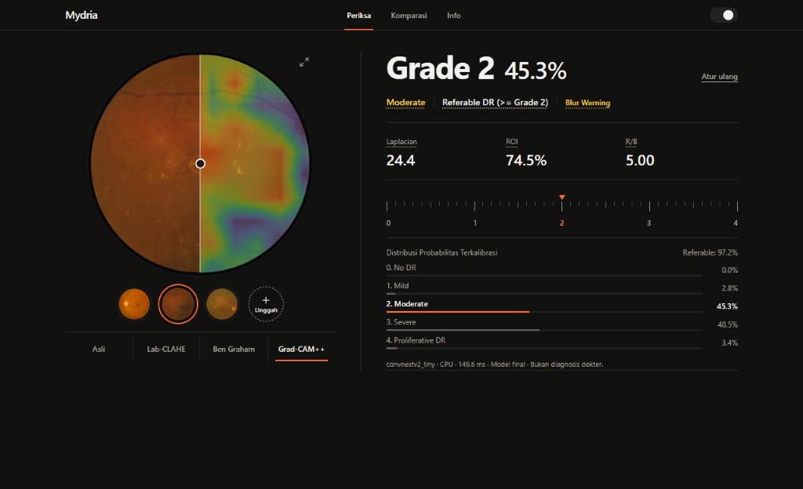
      <br />
      <sub><strong>Mode Gelap (Braun Graphite):</strong> Pembanding belah Asli vs <code>Grad-CAM++</code> dan penggaris taktil 0..4 pada sampel Grade 2 (<code>000c1434d8d7</code>).</sub>
    </td>
    <td align="center" width="50%">
      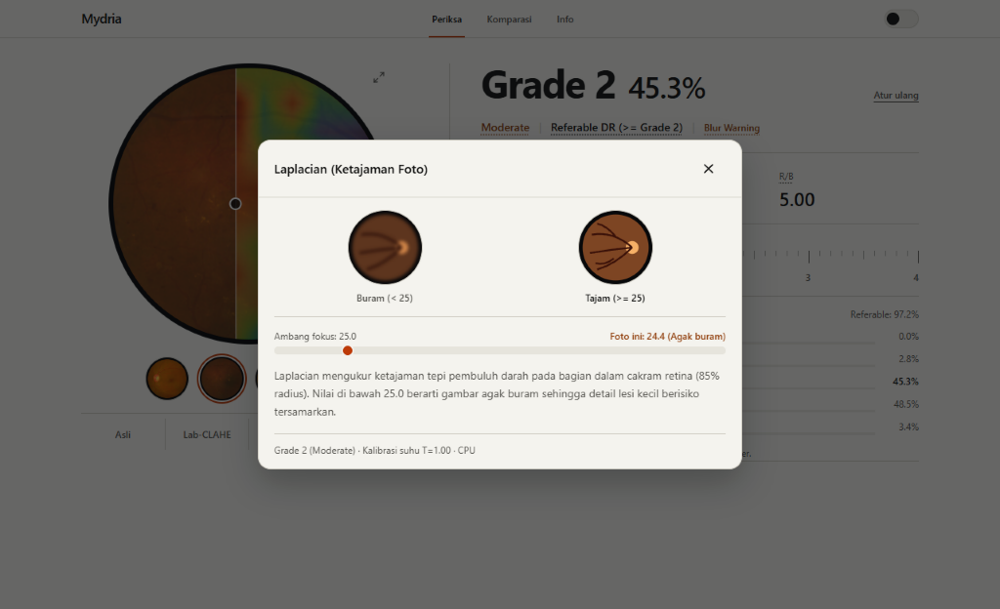
      <br />
      <sub><strong>Dialog Visual Interaktif:</strong> Ketuk label teknis (<code>Laplacian</code>, <code>ROI</code>, <code>R/B</code>, atau status Grade) untuk membuka diagram SVG dan penggaris ambang batas.</sub>
    </td>
  </tr>
  <tr>
    <td align="center" width="50%">
      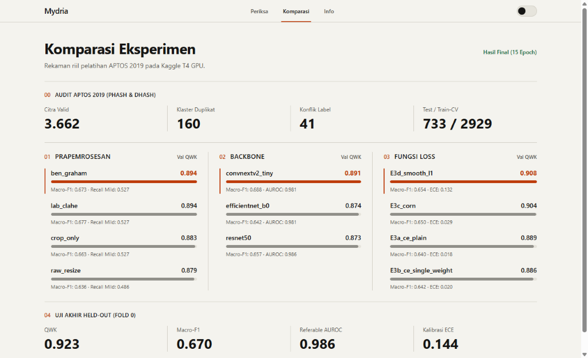
      <br />
      <sub><strong>Tab Komparasi Eksperimen:</strong> Membaca metrik asli dari artefak JSON/CSV Kaggle (<code>E1-E4</code>) serta ringkasan audit dataset.</sub>
    </td>
    <td align="center" width="50%">
      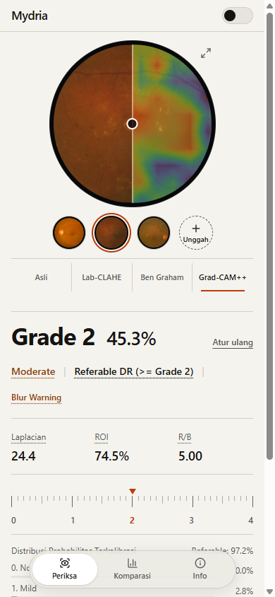
      <br />
      <sub><strong>Seluler (390x844):</strong> Tata letak satu kolom responsif dengan bilah navigasi kapsul bawah tanpa luapan horizontal.</sub>
    </td>
  </tr>
</table>

---

## Hasil Eksperimen

Seluruh eksperimen penuh dijalankan menggunakan `NVIDIA Tesla T4` di Kaggle Notebook (`febfrr/visikom-uas-paket-b-full`, `15` epoch, durasi total `~110,8` menit) pada `3.662` citra dataset **APTOS 2019 Blindness Detection**.

### 1. Audit Kebocoran Dataset (`P2`)

| Metrik Audit APTOS 2019 | Nilai Terukur |
| :--- | :---: |
| Total citra valid (`0` rusak) | **3.662** |
| Klaster unik (`pHash <= 4` dan `dHash <= 4`) | **3.423** |
| Klaster duplikat (`max_cluster_size = 42`) | **160** (mencakup 399 citra) |
| Klaster berkonflik label | **41** (mencakup 87 citra) |
| Partisi bebas kebocoran (`Hold-out Fold 0` / `Train-CV`) | **733** / **2.929** |

### 2. Ringkasan Ablasi `E1` sampai `E3` (Validasi silang pada `2.929` citra `train_cv`)

| Tahap | Konfigurasi Pemenang | Val QWK | Catatan Pembanding |
| :--- | :--- | :---: | :--- |
| **`E1` Prapemrosesan** | **`ben_graham`** (`Circle Crop + Ben Graham`) | **0,8942** | Mengungguli `lab_clahe` (`0,8938`), `crop_only` (`0,8828`), dan `raw_resize` (`0,8786`) |
| **`E2` Arsitektur** | **`convnextv2_tiny`** (`384 x 384`) | **0,8914** | Macro-F1 `0,6883`, mengungguli `efficientnet_b0` (`0,8740`) dan `resnet50` (`0,8730`) |
| **`E3` Fungsi Loss** | **`E3d_smooth_l1`** (`SmoothL1Loss` + `OptimizedRounder`) | **0,9082** | Mengungguli `E3c_corn` (`0,9037`), `E3a_ce_plain` (`0,8889`), dan `E3b_ce_single_weight` (`0,8861`) |

### 3. Evaluasi Akhir *Held-Out Test* (`E4`, `Fold 0`: `733` citra terpisah)

Model final **`ConvNeXt-V2-Tiny` + `Ben Graham` + `SmoothL1Loss`** diekspor ke `model_best.onnx` (`106 MB`, ambang *Nelder-Mead* `[0,5069; 1,4911; 2,5970; 3,4633]`):

| Metrik Evaluasi (`Fold 0` Test) | Nilai Final |
| :--- | :---: |
| **Quadratic Weighted Kappa (QWK)** | **0,9228** |
| **Referable DR AUROC (`>= Grade 2`)** | **0,9864** |
| **Referable DR Sensitivity / Specificity** | **94,97%** / **93,10%** |
| **Accuracy / Macro-F1 / Weighted-F1** | **83,36%** / **0,6700** / **0,8332** |
| **Expected Calibration Error (ECE)** | **0,1445** |

<details>
<summary>Lihat metrik per kelas (`Grade 0..4`) pada Held-Out Test (733 citra)</summary>

| Kelas | Label | Precision | Recall | F1-Score | Support |
| :---: | :--- | :---: | :---: | :---: | :---: |
| `0` | No DR | 0,9917 | 0,9889 | 0,9903 | 361 |
| `1` | Mild | 0,7000 | 0,5676 | 0,6269 | 74 |
| `2` | Moderate | 0,7489 | 0,8350 | 0,7896 | 200 |
| `3` | Severe | 0,3000 | 0,3846 | 0,3371 | 39 |
| `4` | Proliferative DR | 0,7500 | 0,5085 | 0,6061 | 59 |

</details>

### 4. Grafik Pelatihan, Confusion Matrix, dan Galeri `Grad-CAM++`

Seluruh grafik dihasilkan langsung dari berkas `history.csv`, `aptos_audit_summary.json`, dan `E4_heldout_test_metrics.json` menggunakan [scripts/generate_training_plots.py](scripts/generate_training_plots.py):

<table align="center">
  <tr>
    <td align="center" width="50%">
      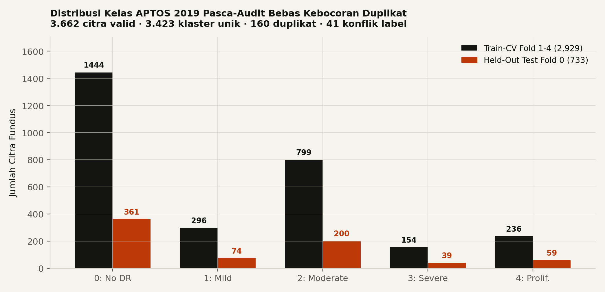
      <br />
      <sub><strong>Distribusi Kelas APTOS 2019:</strong> Partisi bebas kebocoran klaster duplikat pada <code>Train-CV</code> (2.929) vs <code>Held-Out Fold 0</code> (733).</sub>
    </td>
    <td align="center" width="50%">
      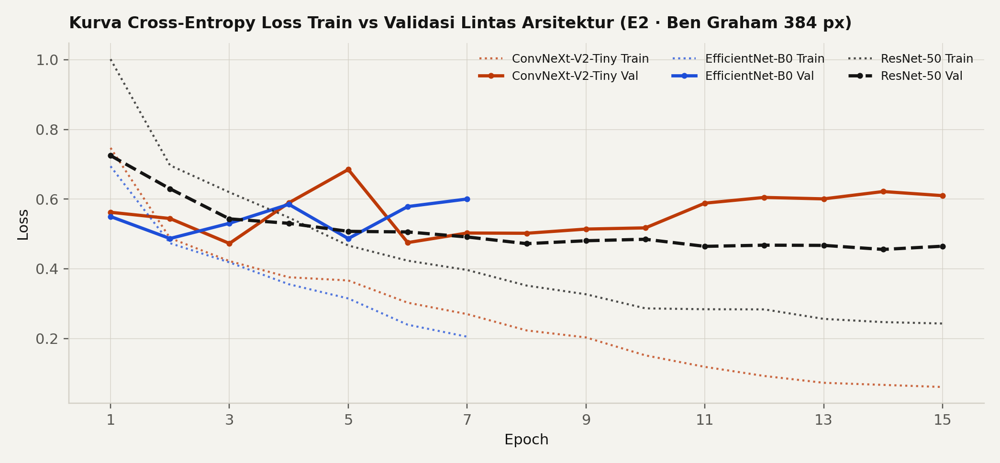
      <br />
      <sub><strong>Kurva Loss Train vs Validasi (<code>E2</code>):</strong> Konvergensi <code>ConvNeXt-V2-Tiny</code>, <code>EfficientNet-B0</code>, dan <code>ResNet-50</code> pada masukan <code>384 x 384 px</code>.</sub>
    </td>
  </tr>
  <tr>
    <td align="center" colspan="2">
      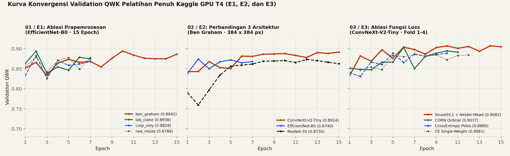
      <br />
      <sub><strong>Kurva Validation QWK (<code>E1-E3</code>):</strong> Ablasi prapemrosesan, komparasi 3 generasi arsitektur, dan keunggulan regresi ordinal <code>SmoothL1 + Nelder-Mead</code>.</sub>
    </td>
  </tr>
  <tr>
    <td align="center" colspan="2">
      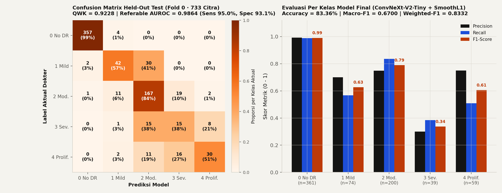
      <br />
      <sub><strong>Confusion Matrix &amp; Metrik Per Kelas (<code>Fold 0</code>):</strong> <code>QWK 0,9228</code> dan <code>Referable DR AUROC 0,9864</code> tanpa kelas yang runtuh ke <code>0,00</code>.</sub>
    </td>
  </tr>
  <tr>
    <td align="center" colspan="2">
      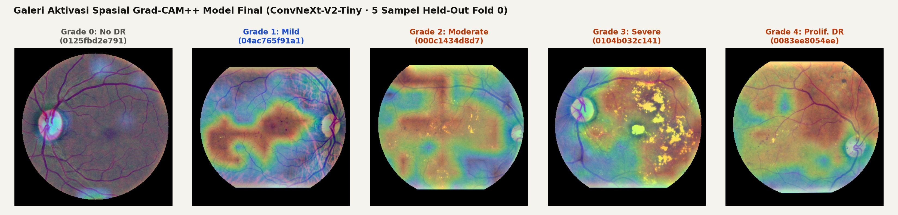
      <br />
      <sub><strong>Galeri Aktivasi Spasial <code>Grad-CAM++</code>:</strong> Peta atensi model final <code>ConvNeXt-V2-Tiny</code> pada lima contoh kelas nyata <code>Fold 0</code>.</sub>
    </td>
  </tr>
</table>

### 5. Kesesuaian dengan Outline Proyek Mata Kuliah

| Butir Outline Awal | Realisasi pada Repositori & Peningkatan Paket B |
| :--- | :--- |
| Audit struktur berkas & larangan evaluasi memakai `test.csv` tanpa label | Terpenuhi penuh oleh [audit_dataset.py](src/visikom_dr/audit_dataset.py), ditambah deduplikasi `pHash`/`dHash` dan `StratifiedGroupKFold` |
| Prapemrosesan citra retina | Terpenuhi dan ditingkatkan dari `224 px` mentah menjadi `384 x 384` `circular_roi_crop` + ablasi `Lab-CLAHE` vs `Ben Graham` |
| Pelatihan & perbandingan `ResNet-50` dan `EfficientNet-B0` | Kedua arsitektur dilatih dan dibandingkan (`0,8730` vs `0,8740` Val QWK), disertai penantang `ConvNeXt-V2-Tiny` (`0,8914`) |
| Penanganan ketidakseimbangan kelas | Terpenuhi lewat ablasi terkontrol `E3` (`CE polos` vs `CE single-weight` vs `CORN` vs `SmoothL1Loss + OptimizedRounder`) |
| Confusion matrix, grafik pelatihan, & metrik per kelas + QWK | Tersedia di `outputs/kaggle_full/` dan dirender ulang otomatis ke `docs/assets/plots/` |
| Aplikasi pratinjau, unggah foto, prediksi Grade 0-4, & batasan klinis | Diimplementasikan lewat web *mobile-first* `Mydria` (`FastAPI + ONNX Runtime + React`), dilengkapi gerbang kualitas OpenCV dan peta panas `Grad-CAM++` |

---

## Arsitektur Sistem

Seluruh fungsi prapemrosesan dan pascapemrosesan berada di paket tunggal [src/visikom_dr/](src/visikom_dr/__init__.py) yang diimpor identik oleh notebook pelatihan maupun server `FastAPI`, sehingga mencegah penyimpangan distribusi citra saat inferensi lokal.

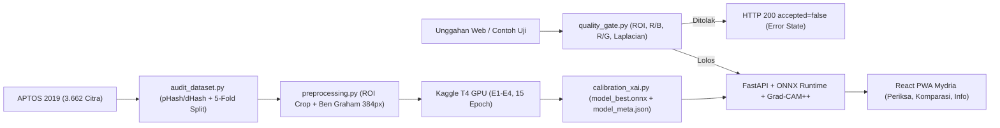

<details>
<summary>Struktur Direktori Monorepo</summary>

```text
Visikom-UAS/
|-- AGENTS.md                     # Aturan kerja, standar validasi, dan aktivasi antislop
|-- DESIGN.md                     # Spesifikasi desain Braun Paper & Graphite + 3 dial
|-- pyproject.toml                # Definisi paket visikom-dr serta dependensi train & serve
|-- backend/                      # Layanan REST FastAPI + pemuat artefak ONNX
|   |-- app.py                    # Pabrik aplikasi FastAPI & mount static frontend/dist
|   |-- config.py                 # Resolusi bobot (models/weights -> outputs/kaggle_full -> smoke)
|   |-- model_service.py          # Quality Gate OpenCV, pemangkasan strip hitam, ONNX, Grad-CAM++
|   |-- metrics_service.py        # Pembaca CSV/JSON eksperimen E1-E4 & ringkasan audit
|   |-- schemas.py                # Skema Pydantic request/response
|   `-- routes/                   # Endpoint /api/health, /api/examples, /api/predict, /api/metrics
|-- frontend/                     # PWA React 19 + TypeScript + Vite + Tailwind CSS v4
|   `-- src/
|       |-- components/
|       |   |-- common/           # ModalSheet (<dialog> lintas browser + transisi top-layer)
|       |   |-- layout/           # AppHeader + NavigationTabs (Desktop tab + Mobile Dock C)
|       |   |-- screening/        # OpticalApertureViewer, TelemetryReadout, ExplanationVisuals
|       |   |-- comparison/       # ComparisonTab & ComparisonTableCard (bilah sinyal Braun)
|       |   `-- methodology/      # MethodologyTab (bagan 01..04 + rincian arsitektur)
|       |-- hooks/                # useScreening, useComparisons, useColorScheme
|       `-- styles/               # tokens.css & components.css
|-- src/visikom_dr/               # Paket Visi Komputer & Deep Learning inti (train + serve)
|-- notebooks/                    # Notebook pelatihan Kaggle/Colab (SMOKE_TEST toggle & auto-resume)
|-- scripts/                      # kaggle_job.py, generate_training_plots.py, validate_docs.py
|-- tests/                        # 11 uji unit (CV, training/ONNX parity, FastAPI endpoints)
`-- docs/                         # Dokumentasi riset, source-ledger (26 sumber), aset SS, progres
```

</details>

---

## Cara Menjalankan

### Prasyarat

- **Python `>= 3.11`** (dengan `pip`)
- **Node.js `>= 20`** dan `npm` (untuk membangun *bundle* frontend `Vite`)
- Opsional: **Kaggle CLI** dengan berkas kredensial `~/.kaggle/kaggle.json` bila ingin mendorong atau mengunduh ulang kernel GPU.

### 1. Instalasi Paket Backend dan Inti Visi Komputer

```powershell
git clone https://github.com/feb027/Visikom-UAS.git
cd Visikom-UAS
pip install -e ".[serve]"
```

> [!TIP]
> Bila ingin menjalankan ulang modul pelatihan atau ekspor model secara lokal, pasang dependensi lengkap melalui `pip install -e ".[train,serve]"`. Pada Windows tanpa GPU CUDA, pustaka `onnxruntime` berjalan memakai `CPUExecutionProvider`, sedangkan GPU AMD/Intel dapat memanfaatkan `onnxruntime-directml`.

### 2. Bangun Frontend (`React + Vite`)

```powershell
cd frontend
npm ci
npm run build
cd ..
```

### 3. Pasang Bobot Model dan Sampel Uji

Backend mencari bobot model secara otomatis pada `models/weights/model_best.onnx` dan `models/weights/model_meta.json`, atau jatuh ke `outputs/kaggle_full/outputs/full/` serta cadangan `outputs/kaggle_smoke/outputs/smoke/`. Untuk menarik ulang keluaran pelatihan penuh dari Kaggle:

```powershell
python scripts/kaggle_job.py output --mode full
Copy-Item outputs\kaggle_full\outputs\full\model_best.onnx models\weights\model_best.onnx -Force
Copy-Item outputs\kaggle_full\outputs\full\model_meta.json models\weights\model_meta.json -Force
```

> [!NOTE]
> Berkas `.onnx` dan direktori `outputs/` serta `models/weights/` dikecualikan dari Git melalui [.gitignore](.gitignore) karena ukurannya mencapai ratusan megabita.

### 4. Jalankan Aplikasi Web (`Mydria`)

Mode produksi lokal (menyajikan *bundle* `frontend/dist/` dan API sekaligus di `http://127.0.0.1:8000`):

```powershell
python -m backend.main
```

Untuk pengembangan antarmuka dengan *hot-reload*, jalankan `python -m backend.main` di satu terminal dan `npm run dev` di dalam folder `frontend/` pada terminal terpisah (`http://127.0.0.1:5173`).

### 5. Pelatihan di Kaggle GPU / Google Colab

- **Automasi Kaggle CLI ([kaggle_job.py](scripts/kaggle_job.py)):**
  ```powershell
  python scripts/kaggle_job.py push --mode full --accelerator NvidiaTeslaT4
  python scripts/kaggle_job.py status --mode full
  ```
- **Google Colab:** Buka [notebooks/paket_b_training_colab_kaggle.ipynb](notebooks/paket_b_training_colab_kaggle.ipynb) dan ikuti panduan di [docs/03-panduan-training-colab-kaggle.md](docs/03-panduan-training-colab-kaggle.md).

### 6. Uji Unit dan Validator Dokumentasi

```powershell
$env:PYTHONPATH="src"; python -m unittest discover -s tests -v
python scripts/validate_docs.py
```

---

## Kontrak API

Seluruh *endpoint* REST disajikan oleh [backend/routes/](backend/app.py) di bawah awalan `/api`:

| Method & Path | Parameter / Masukan | Ringkasan Keluaran |
| :--- | :--- | :--- |
| `GET /api/health` | `-` | Status model aktif, *stage* (`full`/`smoke`/`unavailable`), arsitektur, ukuran input `384`, dan daftar *execution provider* ONNX |
| `GET /api/examples` | `-` | Daftar `3` citra contoh nyata APTOS 2019 *held-out test* beserta tautan pratinjau |
| `GET /api/examples/{example_id}/image` | `?thumb=0\|1` | Citra PNG penuh (`thumb=0`) atau potongan tengah persegi JPEG `160x160` bebas tepi hitam (`thumb=1`) |
| `POST /api/predict` | `multipart file` atau `?example_id=...` | Laporan gerbang kualitas OpenCV (`laplacian_variance`, `roi_area_ratio`, `red_blue_ratio`, `red_green_ratio`), prediksi `Grade 0-4`, `referable_dr`, probabilitas terkalibrasi, serta `viewer_layers` (`original_crop`, `raw_resize`, `lab_clahe`, `ben_graham`, `gradcam_overlay`) dalam data URI PNG |
| `GET /api/metrics` | `-` | Rekaman lengkap `audit_summary`, tabel CSV `E1-E3`, metrik `E4` (`Fold 0`), dan isi `model_meta.json` |

---

## Peta Dokumentasi

| Berkas | Deskripsi |
| :--- | :--- |
| [AGENTS.md](AGENTS.md) | Aturan kerja repositori, integrasi `antislop`, dan kewajiban pencatatan bukti |
| [DESIGN.md](DESIGN.md) | Sistem desain **Braun Paper & Graphite**, palet teruji WCAG AA, serta arah gerak |
| [docs/00-project-brief.md](docs/00-project-brief.md) | Identitas proyek, pembagian tugas 5 anggota kelompok, dan penguncian arsitektur Paket B |
| [docs/01-pre-plan.md](docs/01-pre-plan.md) | Peta fase kerja `P0` hingga `P6` beserta kriteria kelulusan tiap gerbang |
| [docs/02-detail-implementasi-paket-b.md](docs/02-detail-implementasi-paket-b.md) | Spesifikasi teknis modul, protokol partisi, dan matriks ablasi `E1-E4` |
| [docs/03-panduan-training-colab-kaggle.md](docs/03-panduan-training-colab-kaggle.md) | Panduan menjalankan pelatihan di Colab / Kaggle serta pembagian kerja GPU paralel |
| [docs/PROGRESS.md](docs/PROGRESS.md) | Log kronologis eksekusi proyek dan catatan progres terverifikasi |
| [docs/research/source-ledger.md](docs/research/source-ledger.md) | Indeks `26` sumber literatur terverifikasi (`S001-S026`) beserta [references/references.bib](references/references.bib) |
| [docs/research/01-audit-outline-dan-opsi.md](docs/research/01-audit-outline-dan-opsi.md) | Evaluasi teknis terhadap rancangan awal outline tim |
| [docs/research/02-riset-teknis-visikom-dr.md](docs/research/02-riset-teknis-visikom-dr.md) | Tinjauan teknis prapemrosesan fundus, arsitektur `CNN/ViT/ConvNeXt`, dan loss ordinal |
| [docs/research/03-riset-ui-mobile-apple-dan-komputasi.md](docs/research/03-riset-ui-mobile-apple-dan-komputasi.md) | Analisis kebutuhan komputasi *hybrid* serta perancangan UI web responsif |
